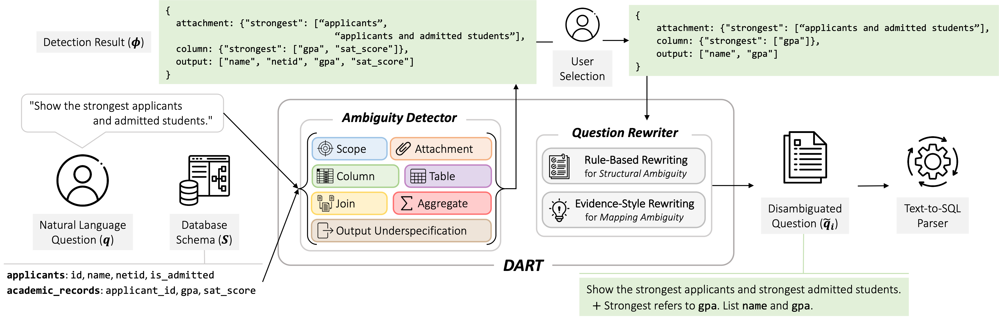

# DART: Towards Resolving Ambiguity in Text-to-SQL via Type-Aware Detection and Rewriting

This repository contains the code and data for the paper "DART: Towards Resolving Ambiguity in Text-to-SQL via Type-Aware Detection and Rewriting."



## Setting up the Environment

Clone the repository:
```
git clone https://github.com/dart-repo/DART.git
cd DART
```

Install the required packages:
```
pip install -r requirements.txt
```

Create a `.env` file in the root directory (see [`env.sample`](env.sample)) and add your OpenAI API key:
```
OPENAI_API_KEY="your-openai-api-key"
```

## Dataset Preparation

DART is evaluated on three **ambiguity-annotated** text-to-SQL benchmarks — **AMBROSIA**, **AmbiQT**, and **CLAMBSQL** — and one **general** text-to-SQL benchmark, **Arcwise-Plat-SQL**, an expert-corrected version of BIRD Mini-Dev that fixes groud-truth SQL but preserves ambiguity in the question.

Download each dataset and arrange the files to match the layout.

### AMBROSIA
Download: https://ambrosia-benchmark.github.io/

```
dataset/ambrosia/
└── data/                       # --db_root_directory
    ├── ambrosia.csv            # --input_path
    ├── attachment/
    ├── scope/
    └── vague/
```

### AmbiQT
Download: https://github.com/testzer0/AmbiQT

```
dataset/ambiqt/
├── benchmark/                  # --input_path
│   ├── col-synonyms/
│   ├── tbl-agg/
│   ├── tbl-split/
│   └── tbl-synonyms/
└── db-content/
    └── database/               # --db_root_directory
```

### CLAMBSQL
Download: https://github.com/mengzhang18/CLEAR

```
dataset/clambsql/
├── clambsql.json               # --input_path
└── database/                   # --db_root_directory
```

### Arcwise-Plat-SQL
- Questions: https://github.com/uiuc-kang-lab/text_to_sql_benchmarks/blob/main/data/arcwise_plat_sql_only_with_diff.json
- Databases: https://bird-bench.github.io/ — use `dev_databases` from the Dev Set.

```
dataset/arcwise_plat_sql/
├── arcwise_plat_sql.json       # --input_path
└── dev_databases/              # --db_root_directory
```

## Preprocess

With the datasets in place and the environment set up, run:
```
sh run/run_preprocess.sh
```
This produces the preprocessed inputs:
```
data/ambrosia/ambrosia.json
data/ambiqt/ambiqt.json
data/clambsql/clambsql.json
data/arcwise_plat_sql/arcwise_plat_sql.json
```

## Running DART

Run the full pipeline — ambiguity **detection → selection → rewriting** — for all four
benchmarks with:
```
sh run/run_main.sh
```

Each run invokes `src/main.py` and writes `detection.json` and `rewriting.json` to
`--output_path`. For a single dataset:
```
python3 -u ./src/main.py \
        --dataset ambrosia \
        --input_path ./data/ambrosia/ambrosia.json \
        --output_path ./data/ambrosia/ \
        --llm_model gpt-4o \
        --auto_select
```

### Arguments

| argument | required | default | description |
|----------|----------|---------|-------------|
| `--dataset` | yes | — | benchmark name (`ambrosia`, `ambiqt`, `clambsql`, `arcwise_plat_sql`) |
| `--input_path` | yes | — | preprocessed input JSON produced by `run_preprocess.sh` |
| `--output_path` | yes | — | directory where `detection.json` and `rewriting.json` are written |
| `--llm_model` | no | `gpt-4o` | LLM used for ambiguity detection |
| `--batch` | no | off | run detection via the OpenAI Batch API |
| `--resume` | no | off | resume a previously submitted batch (use with `--batch`) |
| `--auto_select` | no | off | automatically select interpretations; omit for **interactive** user selection |

With `--auto_select`, interpretations are chosen automatically against the gold SQL. Without
it, selection is interactive — you pick among the detected interpretations for each question.

## SQL Generation

After rewriting, run a downstream text-to-SQL parser over the disambiguated questions to generate SQL predictions:
```
sh run/run_parser.sh
```

Each run invokes `src/parser.py`, which reads a `rewriting.json`, generates SQL for each rewritten question, and writes the predictions to `--output_path` (in a `prediction` field), with a run log at `--log_path`:
```
python3 -u ./src/parser.py \
        --input_path ./data/ambrosia/rewriting.json \
        --output_path ./data/ambrosia/prediction.json \
        --log_path ./data/ambrosia/prediction.log \
        --llm_model gpt-4o
```

## Evaluation

Score the predictions, and evaluation result is saved to `data/<name>/evaluate.out`.:
```
sh run/run_evaluate.sh
```
